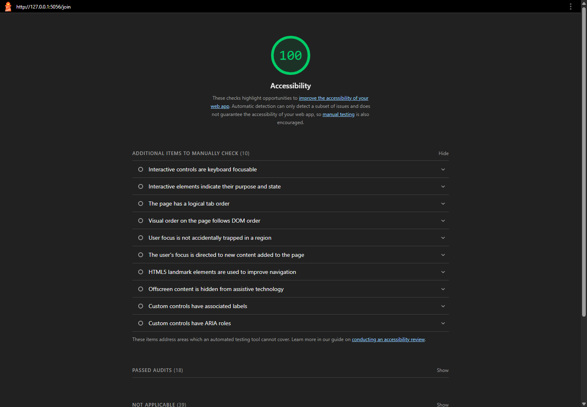
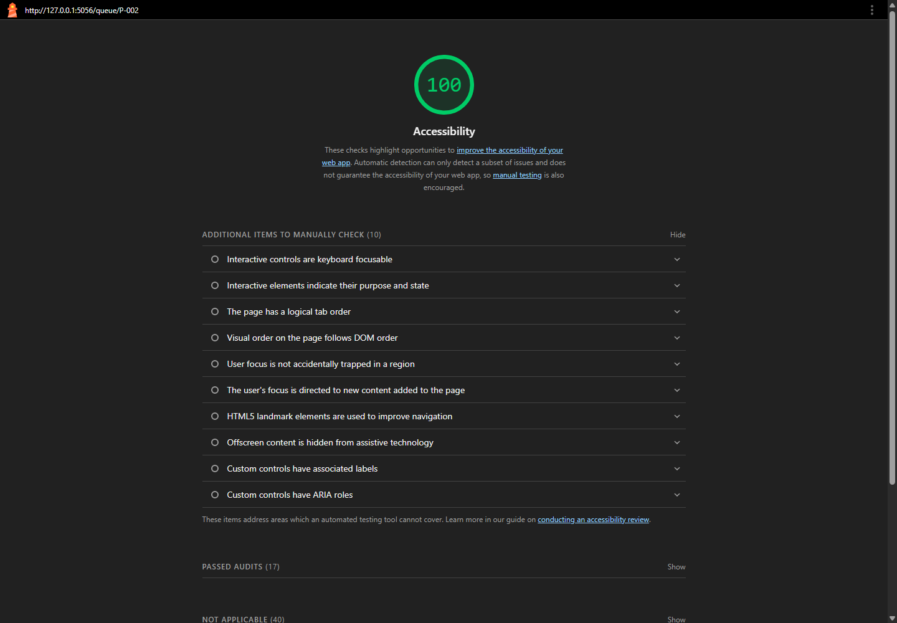
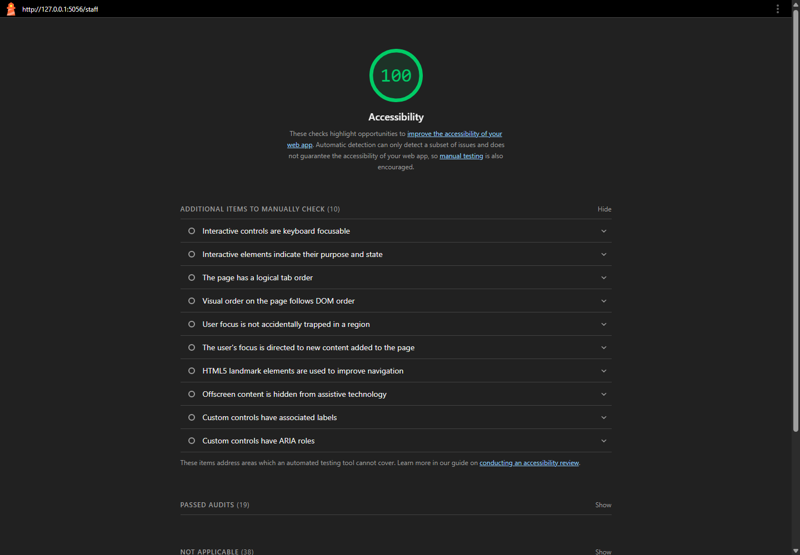

# Week 3 Accessibility Check

Checked on 2026-10-25 at a 375 px mobile viewport. Automated Lighthouse runs used
Lighthouse 12.8.2 with Chrome 136 mobile emulation and the Accessibility
category.

## Lighthouse results

| Screen | URL | Accessibility score |
| --- | --- | ---: |
| Join | `/join` | 100/100 |
| My place | `/queue/P-002` | 100/100 |
| Staff | `/staff` | 100/100 |

### Join

### My place

### Staff

All three final Lighthouse reports passed the automated Accessibility audits.
Lighthouse notes that automated checks cover only a subset of accessibility
issues, so the keyboard and manual checks below were also performed.

## Keyboard-only test

The browser was controlled using Tab, ArrowDown, Enter, and Space key events
only; no mouse clicks were used for the tasks.

- On Home, the first Tab showed the “Skip to main content” link with a visible
  focus ring. Tab reached “Join the queue”; Enter opened the form.
- On Join, Tab reached each labelled field in order. ArrowDown selected a
  service, and Space submitted the form. The ticket page loaded successfully.
- On Staff, Tab reached the service filter. ArrowDown selected a service and
  Enter applied it. Enter activated Call next and then Serve.
- Focus remained visible throughout the keyboard sequence. A full Tab scan
  found no focusable controls without a visible focus indicator on Join, My
  place, or Staff.
- At 375 px, each page fit the viewport without document-level horizontal
  scrolling. On Staff, the wide queue table scrolls inside its responsive
  container.
- The browser console had no errors after adding the app favicon.

The keyboard check initially exposed Bootstrap button focus styling overriding
the shared outline rule. An explicit high-contrast focus ring was added for
buttons and form controls.

## Manual checklist

| Check | Join | My place | Staff |
| --- | --- | --- | --- |
| Every input has a visible label | ✅ Name, email, service, reason, and priority | ✅ Reminder threshold | ✅ Service filter; actions have text or accessible names |
| Error messages say what to do, in text | ✅ Specific field instructions; errors are associated with fields | ✅ Reminder errors and action feedback are text | ✅ Action feedback is text; no inline input validation |
| Status is shown in words, not only color | ✅ N/A; no queue status on this screen | ✅ Status badge contains the status text | ✅ Queue badges contain “waiting” or “called” |
| Text and buttons are readable at 375 px with no sideways page scroll | ✅ No document overflow | ✅ No document overflow | ✅ No document overflow; table scrolls inside its own container |
| Buttons are at least about 44 × 44 px on a phone | ✅ Buttons and inputs are at least 44 px high | ✅ Reminder input and buttons are at least 44 px high | ✅ Buttons and filter are at least 44 px high |
| Page has one `<h1>` and headings in order | ✅ One `<h1>` | ✅ One `<h1>` | ✅ One `<h1>`, followed by section headings |
| `<html lang="en">` (or your language) is set | ✅ | ✅ | ✅ |

The manual checks found and fixed a few issues before the final Lighthouse run:
the Staff filter button and My place leave button needed darker foreground/
background colors, the reminder input needed a larger tap target, and the Join
service error needed an `aria-describedby` association. The favicon was also
added to remove the browser’s missing-icon 404.
