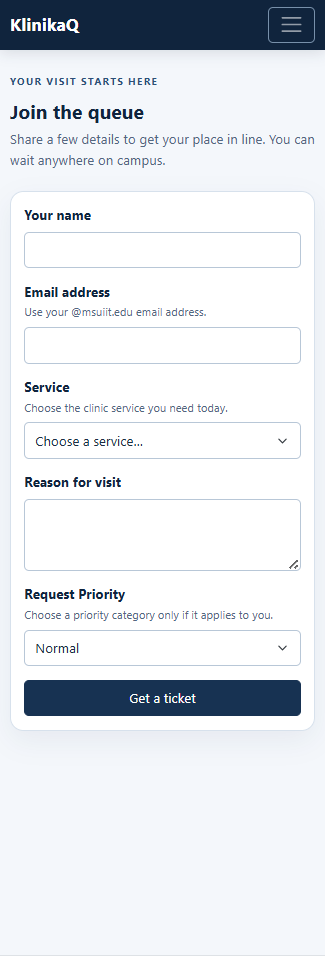
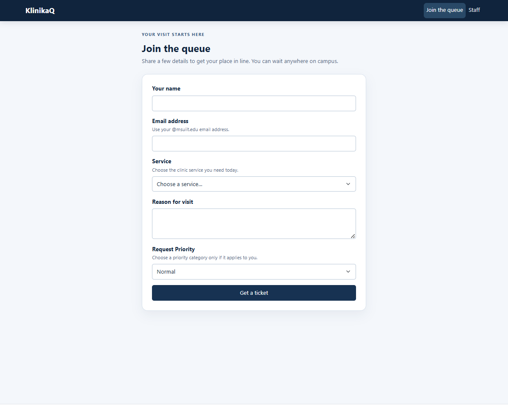
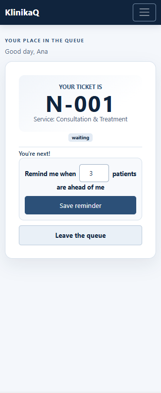
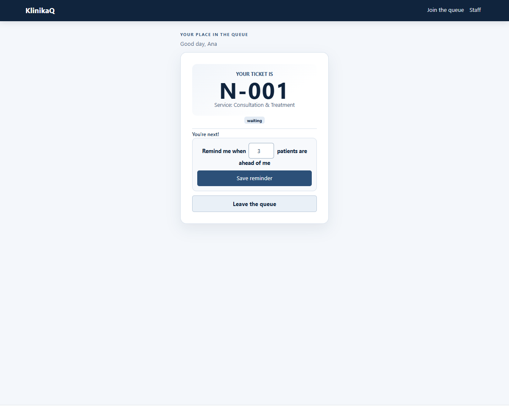
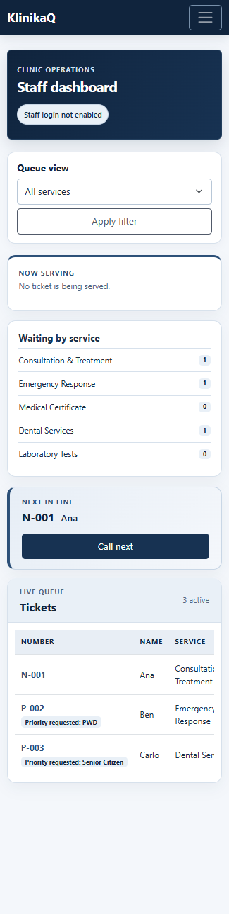
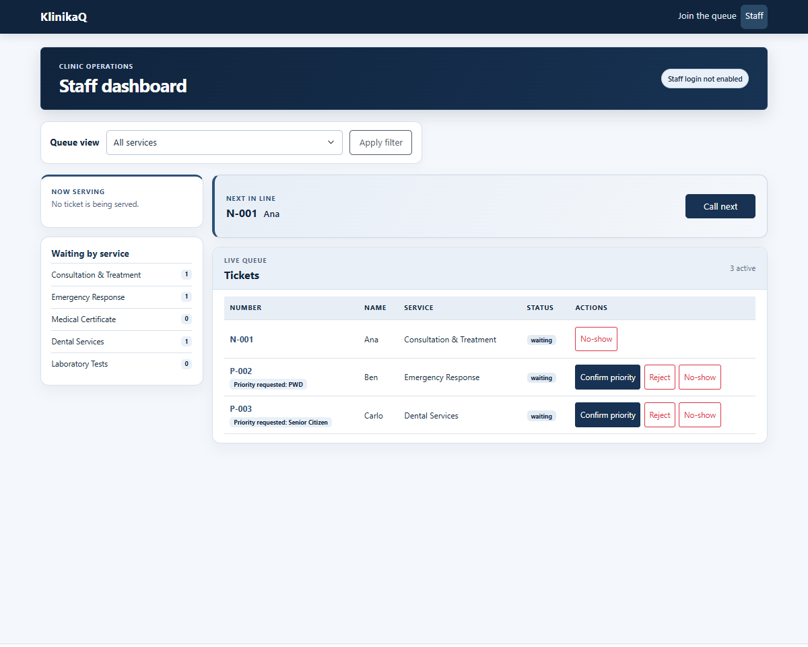

# KlinikaQ — Week 3 interface report

## Title details

- **App:** MSU-IIT KlinikaQ
- **Setting:** MSU-IIT university clinic
- **Name:** Ivan Jay Laguitao
- **Student ID:** 2024-1026
- **Section:** CS3A
- **Date:** 2026-10-25
- **Pull request:** 
## Personas

- **Nurse Leo, clinic staff assistant:** “I want a system that lets them wait
  somewhere else so they don't miss their classes.” His main tasks are to view
  the ordered queue, call the next ticket, and mark tickets served or no-show.
- **Mark, freshman needing a certificate:** “I couldn't leave because I didn't
  know what time my number would be called.” His main tasks are to join for a
  service, check his queue position, and know when to return.

See [the full personas](personas.md).

## Screens

The phone screenshots use a 390 px responsive viewport; laptop screenshots use
a 1440 px viewport.

### Join

Mark uses Join to request a clinic service without waiting at the front desk;
this screen covers **FR-01**.

### My place

Mark uses My place to check his ticket number, status, and position; this screen
covers **FR-02** and **FR-04**.

### Staff dashboard

Leo uses Staff to review the active queue, confirm or decline priority requests,
and call or serve patients; the dashboard covers **FR-04** and **FR-05**.

Priority requests are identified, can be confirmed or declined by staff, and
are prioritized in the queue after confirmation.

## Design decisions

1. **Prominent ticket number and position:** My place gives the ticket number
   and position the strongest visual emphasis because Mark needs to check them
   quickly while away from the clinic.
2. **Short, guided Join form:** Visible labels and short hints explain the
   service and campus email requirements so Mark can complete the request
   without guessing.
3. **Queue actions and priority cues:** Staff sees the next ticket, one-click
   Call next, waiting counts, and a priority badge because Leo needs to act
   quickly while assisting patients.

## Self-review

The original [feedback review](feedback.md) found that a priority request did
not collect supporting details, the Leave action could be confused with the
reminder control, and priority tickets needed stronger visibility.

The current interface separates Leave from the reminder and asks for
confirmation before leaving. The Staff dashboard shows priority badges,
provides confirm/decline actions, and orders confirmed priority tickets first.
The form's priority category is recorded as the request reason; verification
documents are not collected.

## Accessibility

The recorded Lighthouse Accessibility scores are **100/100** for Home, Join,
My place, and Staff. The most important fixes recorded in the
[accessibility check](accessibility.md) include visible keyboard focus,
associating field errors with their inputs, sufficient contrast, and
phone-sized touch targets. Keyboard and manual checks are documented there.

## Usability test

I tested the app with a freshman student. 
- **Task 1 (Join the queue):** Completed successfully in 45 seconds. The participant easily found the "Join" button and understood the form fields.
- **Task 2 (Check position):** Completed successfully. The participant immediately noticed the giant ticket number and the "X people ahead" text without needing to read the whole page.
- **Task 3 (Staff dashboard):** Completed successfully with a laptop. The participant found the "Call Next" button immediately, but accidentally clicked the red "No-show" button while trying to serve a patient.

**Improvement made:** Based on the accidental click in Task 3, I changed the "No-show" action to a red outlined style (`btn-outline-danger`) and visually separated it from the primary "Confirm priority" button. This prevents accidental clicks (error prevention) while maintaining a fast workflow for the staff.

## Reflection

The main design challenge was keeping queue information and actions clear for
both patients on phones and staff at a desktop. In Week 4, I will move tickets
from the in-memory list into a database, preserve ticket identifiers and
service-specific queue positions, and keep staff status transitions consistent
with the patient's live status.

## Declaration

GitHub Copilot (AI) assisted with debugging and validation. Bootstrap 5.3.3 is used for the interface components.
