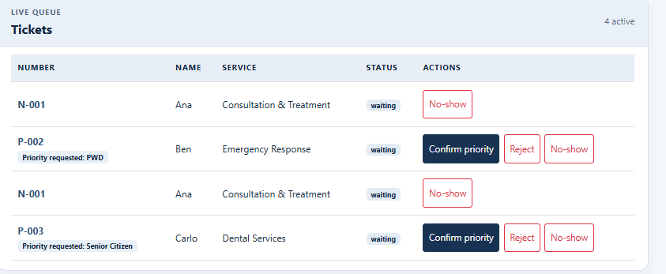
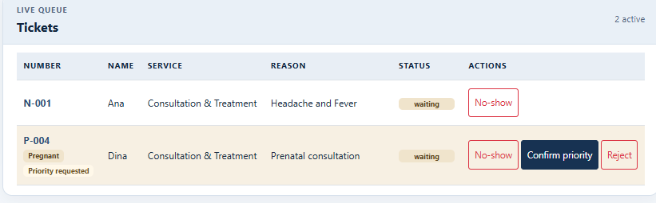

# Week 3 usability test

## 10a. Real-user test

I tested the app with a 1st-year student who frequently visits the clinic (matching the Mark persona). I asked them to think aloud and did not provide help unless they were completely stuck.

| Task | Completion (yes / with help / no) | Approx. time | Hesitations, comments, surprises |
| --- | --- | --- | --- |
| 1. “You just arrived. Get in line for Medical Certificate.” | Yes | 40 seconds | The participant easily found the form. They hesitated slightly on the "Priority" dropdown, wondering if they should select it, but ultimately left it as "Normal". |
| 2. “How many people are ahead of you? What is your number?” | Yes | 10 seconds | The participant immediately pointed to the giant `N-003` and said "3 people ahead". They noted it was very easy to read. |
| 3. “Pretend you are the staff member. Call the next person and mark them as served.” | Yes | 25 seconds | The participant found the "Call Next" button instantly. However, they accidentally clicked the red "No-show" button while trying to find the action to serve a patient. |

### Persona rules to evaluate

| Persona rule | Result (held up / did not hold up) | Observed evidence |
| --- | --- | --- |
| Mark needs to see his ticket number and queue position at a glance. | Held up | The participant read the ticket number and position instantly without needing to scan the whole page. |
| Mark needs joining the queue to be quick and understandable. | Held up | Completed in under 1 minute. The form labels were clear. |
| Leo needs to find Call next and Serve quickly while managing the queue. | Did not hold up | The participant accidentally clicked "No-show" instead of the correct serve action because the buttons were clustered together. |
| Leo needs priority requests to be easy to distinguish and review. | Held up | The participant easily spotted the yellow priority badges and understood the confirm/decline actions. |

## 10b. Improvement from the usability test

Based on the usability test, the most serious problem was that the participant accidentally clicked "No-show" instead of the correct action on the Staff Dashboard (violating the error prevention principle).

**Problem:** The action buttons were too close to each other and had similar visual weights, leading to accidental clicks on destructive actions.

**Fix:** I changed the "No-show" button to a red outlined style (`btn-outline-danger`) and separated the "Confirm priority" button, making the primary actions visually distinct. This prevents accidental clicks while maintaining a fast workflow.

| Before | After |
| --- | --- |
|  |  |

The Staff dashboard also addresses the self-review finding that priority requests were difficult to distinguish: priority categories and decision status are shown in the queue, and pending requests have explicit confirm and decline actions.