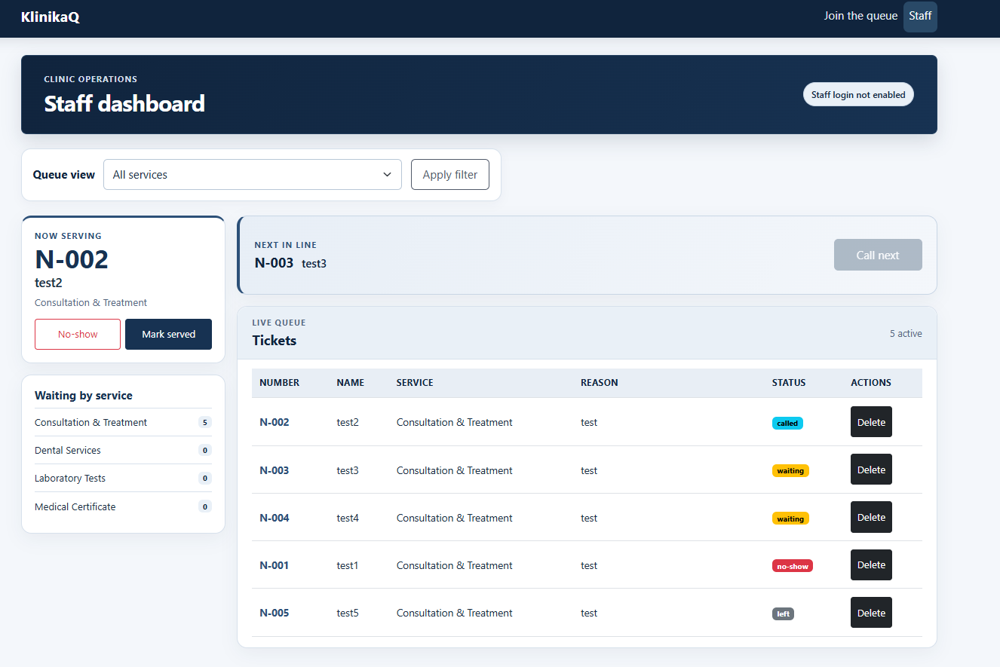
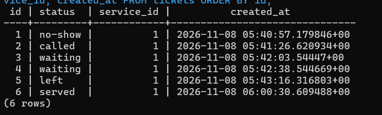
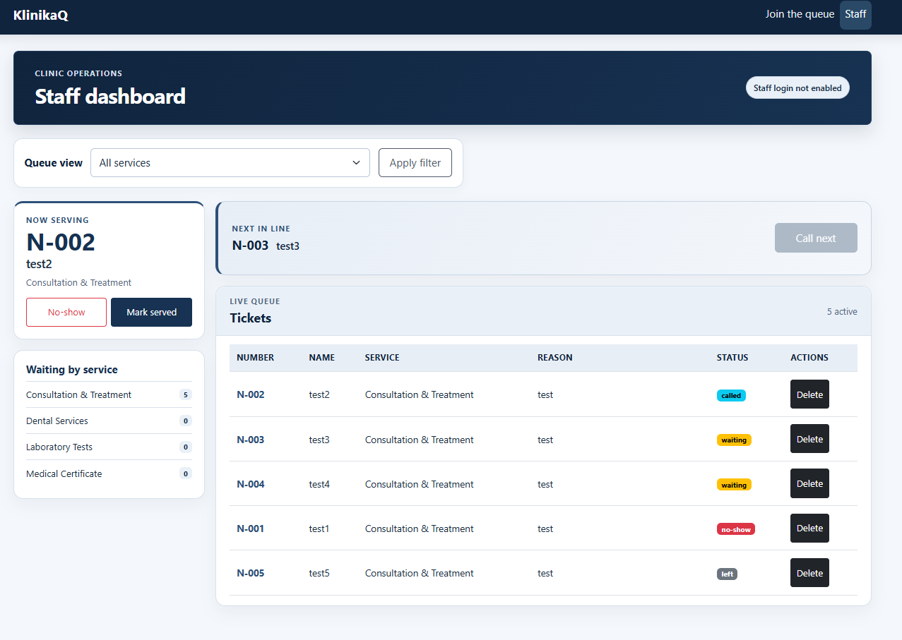
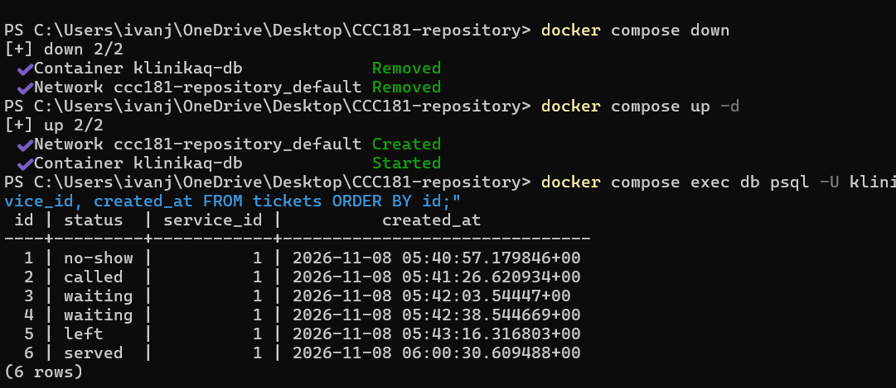

# Persistence Test

## 11a. Restart Test
I created 6 tickets, called one, served one, marked one as a no-show, and 1 ticket left the queue. 
After stopping Docker and Flask, and restarting them, all 6 tickets, statuses, and timestamps were exactly as before. This proves NFR-01 passed.

**Before Restart:**

**After Restart:**

## 11b. Rebuild from scratch
I ran `docker compose down -v`, followed by `up -d`, `flask db upgrade`, and `flask db seed`. 
The app successfully rebuilt the database, loaded the services on the Join form, and allowed new tickets to be created.