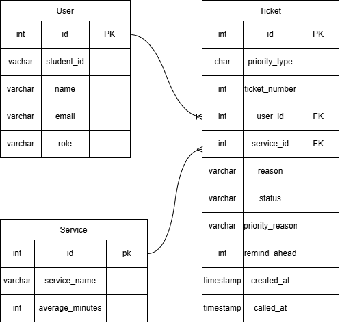
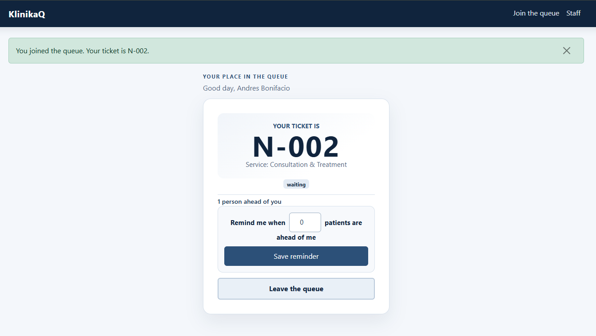
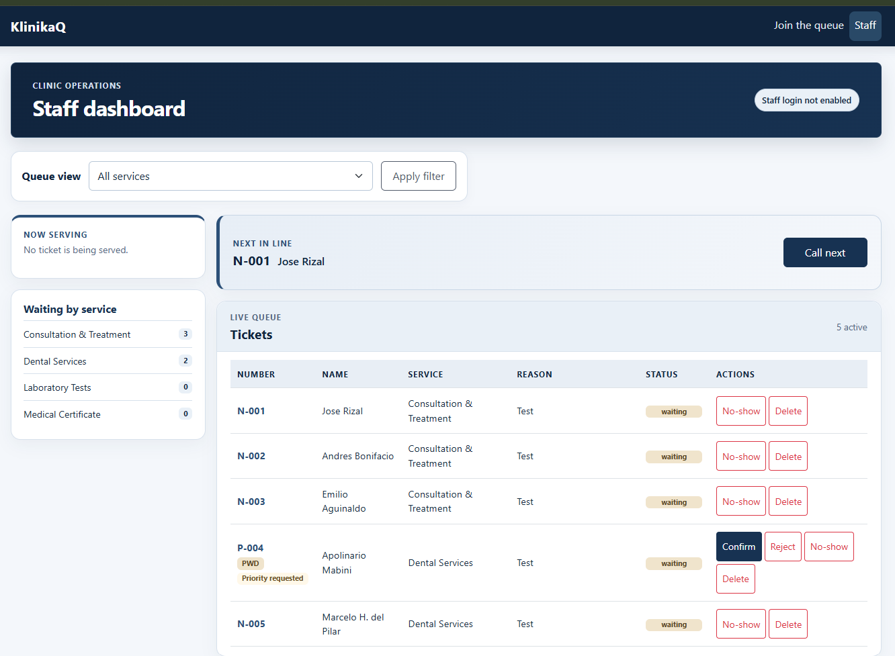
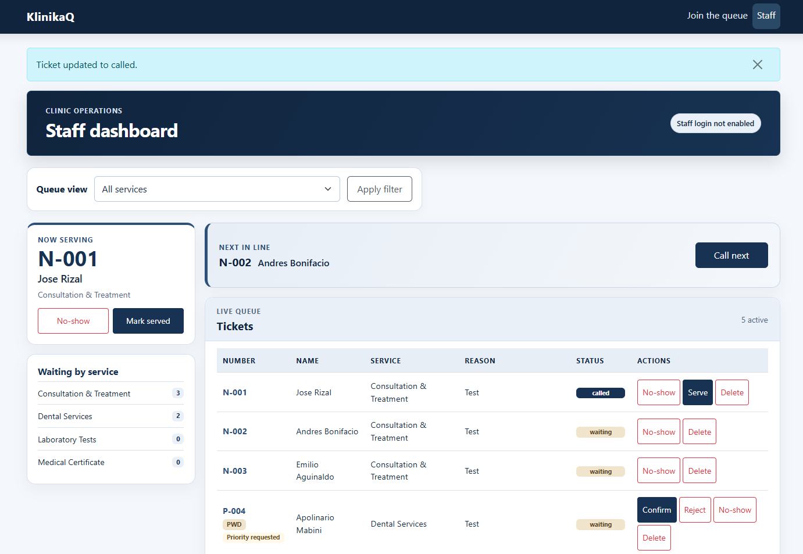
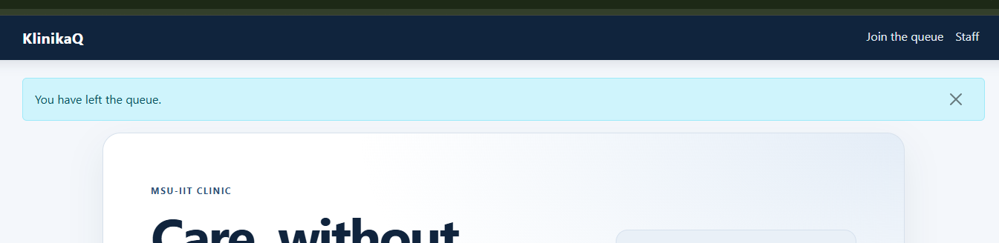
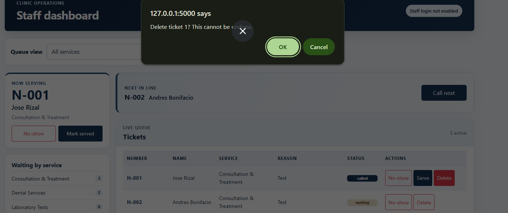
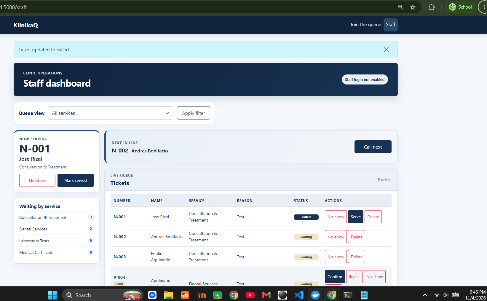
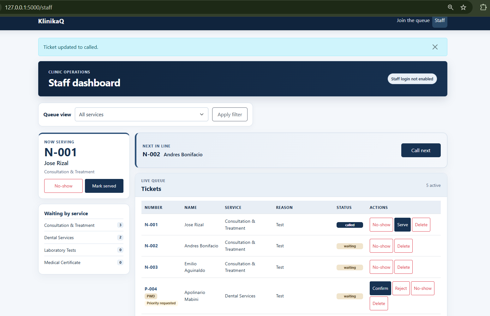

# KlinikaQ: Week 4 Database Report

## Title details

- **App:** MSU-IIT KlinikaQ
- **Setting:** MSU-IIT University Clinic
- **Name:** Ivan Jay Laguitao
- **Student ID:** 2024-1026
- **Section:** CS3A
- **Date:** 2026-11-04
- **Pull request:** https://github.com/IvanJayLaguitao/CCC181-repository/pull/5

## Requirements

I wrote **11 functional** and **5 non-functional** requirements.

**MVP:**

1. Join the queue (FR-01)
2. See my position in the queue
3. Staff confirm a ticket's priority

**Feedback from my setting:** A clinic staff member suggested I record *why* a ticket is priority. **What I changed:** I added a `priority_reason` field to `tickets` (PWD, Senior citizen, Pregnant, Others), which stays empty for normal tickets.

[Link to requirements](../requirements.md)

## ERD



- One user has many tickets (1:N).
- One service has many tickets (1:N).

[Link to schema](schema.md)

## Schema

```text
                                           Table "public.tickets"
       Column       |           Type           | Collation | Nullable |               Default
--------------------+--------------------------+-----------+----------+-------------------------------------
 id                 | integer                  |           | not null | nextval('tickets_id_seq'::regclass)
 priority_type      | character varying(1)     |           | not null | 'N'::character varying
 priority_reason    | character varying(50)    |           |          |
 ticket_number      | integer                  |           | not null |
 reason             | character varying(255)   |           | not null |
 status             | character varying(20)    |           | not null | 'waiting'::character varying
 remind_ahead       | integer                  |           | not null | 3
 created_at         | timestamp with time zone |           | not null | now()
 called_at          | timestamp with time zone |           |          |
 user_id            | integer                  |           | not null |
 service_id         | integer                  |           | not null |
 priority_confirmed | boolean                  |           | not null | false
Indexes:
    "tickets_pkey" PRIMARY KEY, btree (id)
Check constraints:
    "ck_tickets_priority_reason" CHECK (priority_type::text = 'P'::text AND (priority_reason::text = ANY (ARRAY['PWD'::character varying, 'Senior citizen'::character varying, 'Pregnant'::character varying, 'Others'::character varying]::text[])) OR priority_type::text = 'N'::text AND priority_reason IS NULL)
    "ck_tickets_priority_type" CHECK (priority_type::text = ANY (ARRAY['N'::character varying, 'P'::character varying]::text[]))
    "ck_tickets_status" CHECK (status::text = ANY (ARRAY['waiting'::character varying, 'called'::character varying, 'served'::character varying, 'no-show'::character varying, 'left'::character varying]::text[]))
Foreign-key constraints:
    "tickets_service_id_fkey" FOREIGN KEY (service_id) REFERENCES services(id) ON DELETE RESTRICT
    "tickets_user_id_fkey" FOREIGN KEY (user_id) REFERENCES users(id) ON DELETE RESTRICT

                                      Table "public.services"
    Column    |         Type          | Collation | Nullable |               Default
--------------+-----------------------+-----------+----------+--------------------------------------
 id           | integer               |           | not null | nextval('services_id_seq'::regclass)
 service_name | character varying(80) |           | not null |
 avg_minutes  | integer               |           | not null | 10
 active       | boolean               |           | not null | true
Indexes:
    "services_pkey" PRIMARY KEY, btree (id)
    "services_service_name_key" UNIQUE CONSTRAINT, btree (service_name)
Referenced by:
    TABLE "tickets" CONSTRAINT "tickets_service_id_fkey" FOREIGN KEY (service_id) REFERENCES services(id) ON DELETE RESTRICT

                                      Table "public.users"
   Column   |          Type          | Collation | Nullable |              Default
------------+------------------------+-----------+----------+-----------------------------------
 id         | integer                |           | not null | nextval('users_id_seq'::regclass)
 student_id | character varying(20)  |           |          |
 name       | character varying(80)  |           | not null |
 email      | character varying(120) |           | not null |
 role       | character varying(20)  |           | not null | 'student'::character varying
Indexes:
    "users_pkey" PRIMARY KEY, btree (id)
    "users_email_key" UNIQUE CONSTRAINT, btree (email)
    "users_student_id_key" UNIQUE CONSTRAINT, btree (student_id)
Check constraints:
    "ck_users_role" CHECK (role::text = ANY (ARRAY['student'::character varying, 'faculty'::character varying, 'staff'::character varying]::text[]))
Referenced by:
    TABLE "tickets" CONSTRAINT "tickets_user_id_fkey" FOREIGN KEY (user_id) REFERENCES users(id) ON DELETE RESTRICT
```

## Design decisions

1. **`priority_type`, `priority_reason` and `priority_confirmed` live on `tickets`, not `users`.** Priority applies to a single visit: someone may need the priority lane today and not next time. Staff also confirm priority per ticket (my MVP), so `priority_confirmed` defaults to `false` until staff check it.
2. **A CHECK constraint ties `priority_reason` to `priority_type`.** The clinic staff member asked for a reason on priority tickets, so a `P` ticket must have one of the four allowed reasons and an `N` ticket must have none. The database enforces this even if the app has a bug.
3. **Leaving the queue sets `status = 'left'` instead of deleting the row, and foreign keys use `ON DELETE RESTRICT`.** Keeping the row means the history survives, which my staff persona needs to see how many people gave up before being served. `RESTRICT` stops a user or service with tickets from being deleted by accident.

## Self-review

- I originally forgot `student_id`. Then I realized faculty and staff do not have one, so I made it nullable (it is still unique).
- I made sure `priority_reason` can be `NULL` so normal tickets do not need a reason.

## Migrations

- `..._initial_tables.py`: Creates the initial `users`, `services` and `tickets` tables.
- `..._add_services_active.py`: Adds the `active` boolean column to `services`.

## CRUD

| Operation | Route | Requirement | Screenshot |
|---|---|---|---|
| Create: join the queue | `/join` | FR-01 |  |
| Read: staff dashboard | `/staff` | FR-03 |  |
| Update: call or serve a ticket | `/staff/tickets/<id>/<action>` | FR-04 |  |
| Soft delete: leave the queue | `/queue/<id>/leave` | FR-05 |  |
| Hard delete: delete a ticket | `/staff/tickets/<id>/delete` | FR-06 |  |

## Validation

I tested bad data using `curl` and `psql` (full details in `validation.md`).

- Flask rejected bad emails with a `400` error.
- PostgreSQL rejected duplicate emails (unique constraint) and invalid statuses (check constraint).

**Most useful PostgreSQL error:** While testing an excessively long name (200 characters), my app threw a `500 Internal Server Error` instead of a clean validation message. This proved to me that the database was correctly enforcing the `varchar(80)` column limit, but my Flask app lacked the proper check. I realized the database acts as the final security gatekeeper, and it prevented bad data from being saved, protecting the database's integrity even when my app failed to catch it first. I then added a Python validation `len(name) > 80` to handle it gracefully with a 400 error.

## Persistence

**Before restart:**



**After restart:**



All 5 tickets survived a Docker and Flask restart. The database also rebuilt successfully from scratch. **NFR-01 (no ticket lost on restart) passed.**

## Reflection

- **Hardest part this week:** The hardest part was making the "Join the Queue" feature work correctly. Because we needed the daily ticket number to reset at midnight in Philippine Time, I had to learn how to use PostgreSQL timezone functions (`AT TIME ZONE 'Asia/Manila'`) to calculate the daily count accurately. Getting that logic right without accidentally giving two people the same ticket number took a lot of trial and error.
- **Hardest requirement to write in a testable way:** FR-02 ("A student can see their position in the queue"). It was difficult to make testable because the "position" isn't a fixed number stored in a database column. It constantly changes based on who is waiting and who has priority. I had to write a specific test that checked the JSON output (`/status.json`) to prove that a ticket's position correctly decreases when the person ahead is served.
- **Report my staff persona would want:** "How many people left before being served, per service, per day," so they can see when students are giving up. I will write this query in Week 5.
## Declaration

Claude (AI) assisted with debugging and with formatting this report.