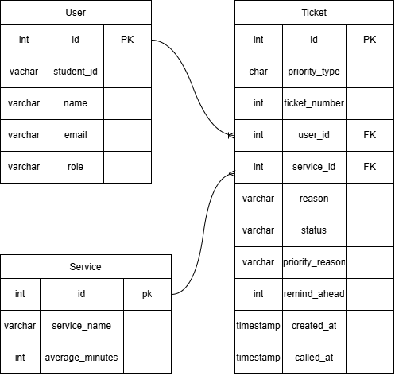

# KlinikaQ Schema Design

## 2a. Find the nouns in your requirements

| Req ID | Requirement | Nouns | Table or column? |
| --- | --- | --- | --- |
| FR-01 | A **student** can join the **queue** for a **service** by entering their **name** and **email**. | student, queue, service, name, email | users, *(not a table)*, services, users.name, users.email |
| FR-02 | A student can see their **ticket number**, **status**, and how many people are **ahead** of them. | ticket number, status, ahead | tickets.ticket_number, tickets.status, *(computed)* |
| FR-03 | A **staff member** can call the next **waiting ticket** for a service. | staff member, ticket, status | users, tickets.status, *(computed)* |
| FR-04 | A staff member can mark a called ticket as **served** or **no-show**. | status | tickets.status |
| FR-05 | A student can **leave the queue** before being called. | status | tickets.status |
| FR-06 | A staff member can add, rename and **switch off** a **service**. | service, active status | services.service_name, services.active |
| FR-08 | A senior citizen or person with a disability can join a **priority lane**. | priority, reason | tickets.priority_type, tickets.priority_reason |
| FR-09 | A student can request **priority status** (PWD/Senior). | priority, reason | tickets.priority_type, tickets.priority_reason |
| FR-10 | A staff member can **confirm** or **reject** a priority request. | priority confirmed | tickets.priority_type, tickets.priority_reason |

**Two rules from the lecture:**
- **The queue is not a table:** It is all tickets with the status `waiting`, ordered by the time they joined.
- **Store facts, not results:** We store `created_at` instead of a "position" number, because positions change every time someone joins or leaves.

## 2b. List your tables and columns

| Table | Columns |
| --- | --- |
| `users` | id, student_id, name, email, role |
| `services` | id, service_name, average_minutes |
| `tickets` | id, priority_type, ticket_number, user_id, service_id, reason, status, priority_reason, remind_ahead, created_at, called_at |

## 2c. Choose types and constraints on purpose

| Table | Column | PostgreSQL type | Constraint | Why |
| --- | --- | --- | --- | --- |
| users | id | integer | PRIMARY KEY | Generated by the database, never reused |
| users | student_id | varchar(20) | UNIQUE | Identifies the student |
| users | name | varchar(80) | NOT NULL | Every user needs a name |
| users | email | varchar(120) | NOT NULL UNIQUE | One account per email |
| users | role | varchar(20) | NOT NULL, CHECK (role IN ('student','faculty', 'staff')) | Only student, faculty, and staff |
| services | id | integer | PRIMARY KEY | Generated by the database |
| services | service_name | varchar(60) | NOT NULL UNIQUE | One service per name |
| services | average_minutes | int | NOT NULL | Average minutes per services
| tickets | id | integer | PRIMARY KEY | Generated by the database |
| tickets | priority_type | varchar(1) | NOT NULL, CHECK (priority_type IN ('N', 'P')) | Only N or P |
| tickets | priority_reason | varchar(50) | CHECK (priority_reason IN ('PWD', 'Senior citizen', 'Pregnant', 'Others')) | Priority reasons are only for Priority tickets
| tickets | ticket_number | integer | NOT NULL | The daily number (001, 002, 003...) |
| tickets | reason | varchar(200) | NOT NULL | Why they are visiting |
| tickets | status | varchar(20) | NOT NULL, CHECK (status IN ('waiting', 'called', 'served', 'no-show', 'left')) | Only these statuses are allowed |
| tickets | remind_ahead | integer | NOT NULL DEFAULT 3 | How many people ahead triggers a reminder |
| tickets | created_at | timestamptz | NOT NULL DEFAULT now() | Time zone safe; set by the database |
| tickets | called_at | timestamptz | (nullable) | Waiting tickets haven't been called yet |
| tickets | user_id | integer | NOT NULL REFERENCES users(id) ON DELETE RESTRICT | No ticket for a missing user |
| tickets | service_id | integer | NOT NULL REFERENCES services(id) ON DELETE RESTRICT | No ticket for a missing service |

## 2d. Draw the ERD

**Read the relationships aloud:**
- One **user** has many **tickets** (1:N).
- One **service** has many **tickets** (1:N).
- Each ticket belongs to exactly one user and one service.

**Delete rules:**
For both foreign keys (`user_id` and `service_id`), we use `ON DELETE RESTRICT`. This means if someone tries to delete a user or a service that has tickets, the database will block it. The clinic needs the ticket history for reports, so we cannot cascade the delete.

## 2e. Check that it is normalized

1. **One value per cell (1NF):** Yes. No column holds a list. Each ticket has exactly one status and one priority type.
2. **Depends on the whole key (2NF):** Not applicable, because i did not include any many-to-many join tables. All tables have a single primary key.
3. **No hidden copies (3NF):** Yes. The user's name and email live only in the `users` table. The service's name lives only in the `services` table. The `tickets` table only stores the `user_id` and `service_id`.